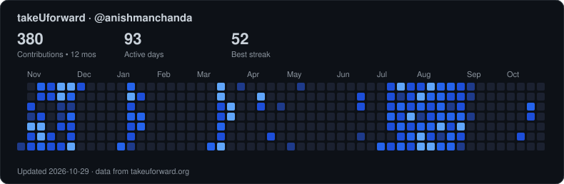

# Hi, I'm Anish 👋

B.Tech CS (AI) student at USICT (GGSIPU), Delhi — class of 2028. I build backend systems, LLM pipelines and native Apple apps, and I like debugging things down to the byte.

## ⚡ What I work with

- **Backend & APIs:** Python, FastAPI, Node.js/Express, REST, async processing
- **AI / GenAI:** RAG (hybrid FAISS + BM25 retrieval), multi-provider LLM integration, agent workflows, LLM-as-a-Judge evaluation
- **Full-stack:** React, Next.js, TypeScript, PostgreSQL, MongoDB, SQLite
- **Native Apple apps:** Swift, SwiftUI, AppKit, watchOS, Bluetooth
- **Infra:** Docker, GitHub Actions CI/CD, AWS, Linux

## 🛠 Projects

**[BookBuddy](https://github.com/keshavgoel1320/Cuet-with-ui)** · TypeScript, Python · [live](https://bookbuddy.pepperlabsai.com/) · top contributor (repo: `Cuet-with-ui`)
A CUET exam-prep platform built at Pepper Labs AI: a Next.js progressive web app on a FastAPI backend with a production RAG pipeline, using hybrid FAISS + BM25 retrieval with citation-aware context. I built the multi-provider LLM layer (OpenAI, Gemini, Groq, SambaNova) with failure handling and fallback, migrated the backend off Mistral, and fixed an async bug that fired every LLM call 3× per request.

**[DockWidgets](https://github.com/anishmanchanda/DockWidgets)** · Swift · ⭐ 5
A macOS utility that puts transparent widgets in the unused space beside the Dock: a flip clock, weather, and media controls for Apple Music and Spotify.

**[sony-ult-ctl](https://github.com/anishmanchanda/sony-ult-ctl)** · [open PR upstream](https://github.com/Leonard013/sony-ult-ctl/pull/1)
A macOS menu-bar app that controls Sony ULT WEAR headphones over Bluetooth RFCOMM. I reverse-engineered the undocumented binary protocol by probing candidate payloads and reading the firmware's own replies. That found the level byte the device was ignoring, which fixed ambient-sound control that had never worked. I also added a live 0–20 transparency slider and rebuilt the receive path so the app shows the headphone's real state, even when you change it from the earcup.

**[Agent Watch](https://github.com/anishmanchanda/claude-watch)** · Swift
Approve your coding agent's actions from your Apple Watch. In my fork I rewrote notification delivery on watchOS and iOS so each prompt shows its real options, split the bridge server's hook routes to match Claude Code's contract, added background polling and persistent pairing, and added Codex support by tailing its JSONL session logs. Debugged on a physical iPhone and Watch.

**[First Reply](https://github.com/anishmanchanda/First-Reply)** · Python
Automated freelance-enquiry intake with Notion as the control panel. An LLM extracts budget, timeline and stack, judges fit and drafts a reply. A human approves in Notion, and only then does the email send over SMTP. Nothing goes out without approval.

**[Wall Calendar](https://github.com/anishmanchanda/calendar-assignment-TUF)** · React + TypeScript
A wall calendar with 3D page-flip animations, per-month theming computed from each hero image, range selection with notes, and full keyboard navigation.

**[SonyHeadphonesClient](https://github.com/anishmanchanda/SonyHeadphonesClient)** — a fork adding support for the ULT WEAR (WH-ULT900N).

## 🧩 Problem solving

[Codeforces](https://codeforces.com/profile/anishmanchanda) · [LeetCode](https://leetcode.com/anishmanchanda) · [takeUforward](https://takeuforward.org/profile/anishmanchanda)

## 💼 Experience

- **MCT India Infotech** — Backend Engineering Intern (May–Jul 2026): Python backend for a real-time conversational voice agent (session orchestration, multi-turn streaming, REST integrations), plus an LLM-as-a-Judge evaluator that ran scheduled regression checks over call logs.
- **Pepper Labs AI** — AI/ML Engineering Intern (Feb–Apr 2026): shipped a production RAG pipeline for CUET exam prep, built a multi-provider LLM layer (OpenAI, Gemini, Groq, SambaNova) with fallback, and fixed an async bug that fired every LLM call 3× per request.
- **USICT TechSpace** — Computer Vision Intern (Jan–Feb 2026): OCR pipeline digitising handwritten rural invoices into SQL, with Chart.js dashboards.
- **Excel Health-Tech Devices** — Software Engineer Intern (Dec 2025–Jan 2026): WhatsApp-first inventory system in FastAPI with an async expiry-alert scheduler for a 10+ person team.

## 🧰 Stack

`Python` `TypeScript` `JavaScript` `SQL` `Swift` `C/C++` `Java` `FastAPI` `Node.js` `Express` `React` `Next.js` `SwiftUI` `PostgreSQL` `MongoDB` `SQLite` `FAISS` `Docker` `GitHub Actions` `AWS` `Git` `Linux`

## 🤝 Let's connect

[LinkedIn](https://linkedin.com/in/anish-manchanda) · anishmanchanda2006@gmail.com
